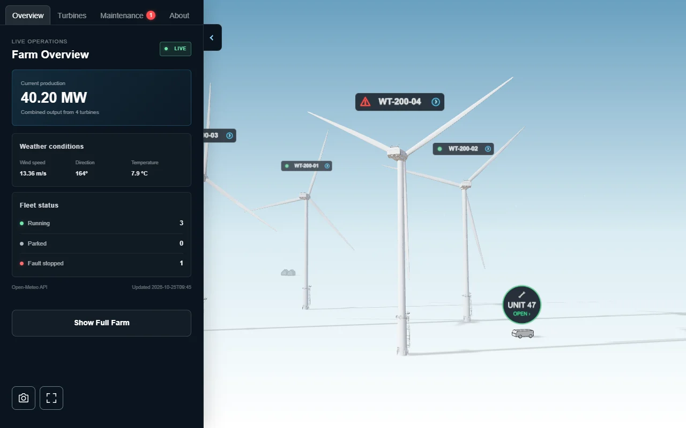
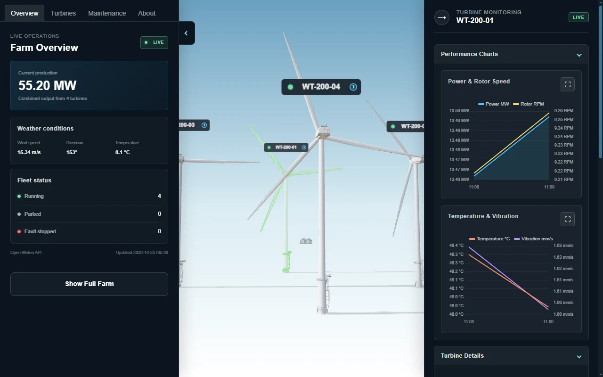
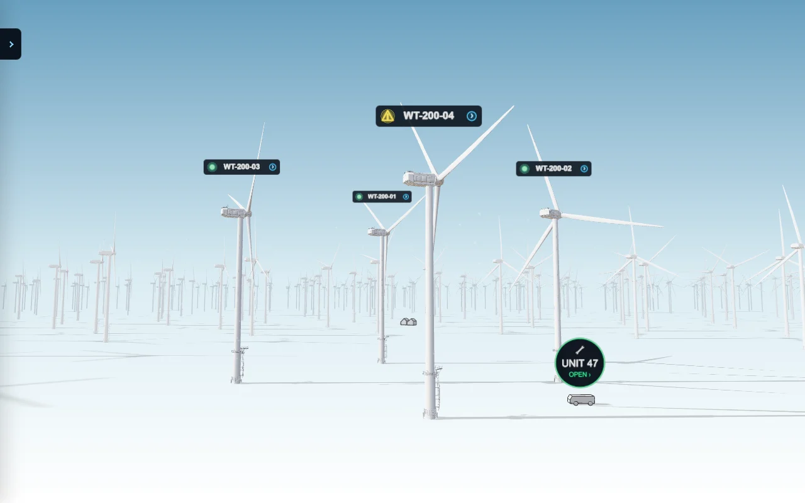
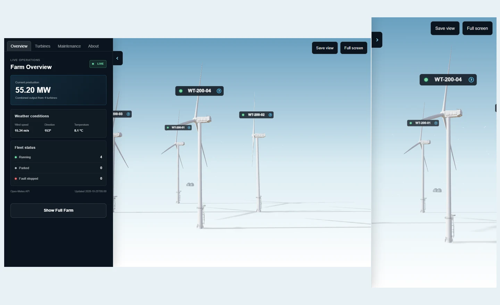

# WindTwin — Operational Wind Farm Digital Twin

[**Explore the live experience →**](https://windtwin.nourtin.com/) · [Portfolio case study](https://nourtin.com/pages/Subpages/windtwin-case-study.html) · [Nour Altinawi / Nourtin](https://nourtin.com/)

A browser-based industrial 3D experience connecting **asset monitoring, environmental context, simulated maintenance, and an animated service workflow** in one wind-farm environment.

**Role:** Real-time 3D development, frontend application development, interaction and interface design, operational simulation, performance optimization, and validation.

**Platform:** Desktop and mobile web.

**Built with:** Three.js / WebGL, TypeScript, Vite, Chart.js, HTML, CSS, and Open-Meteo.

## The project

WindTwin explores how an industrial digital twin can become an understandable operational interface rather than a passive 3D scene. Visitors can select an asset, inspect its condition, follow an alert into a work order, and observe a maintenance vehicle carrying out the simulated service process.

Four primary turbines form the interactive operational core. An expanded view presents a 100-turbine environment to demonstrate the farm's wider spatial context. The additional display turbines are not 96 extra managed maintenance assets.

## Experience at a glance

| Area | What the visitor can do |
| --- | --- |
| Farm overview | Read combined simulated production, fleet status and current weather context. |
| Asset inspection | Select a primary turbine in the scene or asset list and inspect its condition. |
| Monitoring | Follow simulated power, rotor speed, temperature and vibration through rolling charts. |
| Maintenance | Review alerts and tickets, change queue priorities, and follow service progress and completed reports. |
| Service vehicle | Observe travel, servicing and return activity and inspect the current mission. |
| Operations Center | Explore demonstration personnel, supplies, fleet information and employee profiles. |
| Camera views | Open illustrated turbine camera panels for additional visual context. |
| Expanded farm | Switch between the focused operational scene and the 100-turbine display environment. |
| Presentation | Save a branded scene image and enter fullscreen where supported. |

## 1. Understand the farm at a glance

The overview brings weather, production and fleet status into a compact dashboard beside the 3D scene. Live weather provides environmental context while operational values remain a simulated demonstration. The interface links the farm's overall picture to individual assets, helping visitors move from an overview to a specific turbine without leaving the experience.

## 2. Inspect an asset and its condition

Selecting a primary turbine connects its 3D identity to condition information, operating values and monitoring charts. Visitors can compare power and rotor speed with temperature and vibration, then expand a chart for a closer view.

*Turbine values and chart samples are simulated. A monitoring-style LIVE label is not evidence of a connection to physical turbine sensors.*

## 3. Follow maintenance as a connected workflow

Simulated faults connect asset condition to alerts, work orders and service activity. The maintenance queue exposes priority and sequencing, while ticket details provide access to the current job and its progress.

A service vehicle travels to the assigned turbine and performs the simulated repair. Completed work appears in maintenance history, linking the original issue to the resulting report and recovered asset state.

This makes the relationship between **condition, decision, dispatch and outcome** visible within the same experience. Work orders and reports belong to the browser session; they are not records from a production maintenance backend.

## 4. Explore the wider environment

Full Farm expands the display to 100 turbines while retaining the four primary operational assets. It adds a sense of industrial scale and lets visitors navigate the broader farm context.

## 5. Keep operations and context together

Operations Center and service-vehicle views bring personnel, supplies, mission information and demonstration fleet records into the interface. Employee profiles and illustrated camera views add context without requiring a separate application.

Personnel, inventory, camera images and several detail indicators are demonstration content. Employee buttons illustrate interface behavior rather than performing workforce or inventory transactions.

## 6. Use the experience across devices

The responsive interface supports desktop and mobile layouts with touch navigation. Asset selection on mobile moves visitors from the list into monitoring, keeping the focused task visible.

The latest viewer tools group branded image capture and supported fullscreen viewing in Overview. Export captures the 3D scene with Nourtin branding, rather than the HTML dashboard.

  

*The mobile image shows browser viewport emulation, not physical-phone performance validation.*

## Performance and experience quality

The latest update focuses on the first useful scene, responsive navigation and reliable access to the operational tools. Loading failures provide a retry path, and an interrupted weather service preserves a labelled simulated experience.

The maintained graphics baseline is **Three.js 0.186.1**. The update preserves the established material and lighting presentation while modernizing application libraries and improving startup and runtime behavior.

One recorded local production-build comparison observed the useful-scene proxy at **3.392 seconds before the update and 2.761 seconds after it** on desktop. The observer measured overlay removal followed by two browser frame opportunities, with START clicked automatically. This differs from manual visitor waiting time and from the collector's own visibility method.

Test conditions: Windows, Intel Core i7-5930K, NVIDIA GTX 1060 3GB, headless Chrome 155, 1280 × 800 viewport at DPR 1, local production preview, browser cache disabled, imposed 40 ms latency and 10 Mbit/s download throughput. Driver/shader/OS caches were not reset. This is a single recorded comparison, not a statistically established speedup or a cross-device guarantee.

Verification also covered startup, turbine selection, charts, full-farm show/hide, image export, fullscreen and loading-failure recovery on desktop and an emulated mobile viewport. Physical phones, exhaustive maintenance interactions and long-duration resource testing remain separate validation work.

## My contribution

- Developed the wind-farm environment and connected its primary assets to the operational interface.
- Designed the monitoring dashboard, responsive panels and asset-selection experience.
- Built the demonstration fault, work-order, vehicle and maintenance-report workflows.
- Integrated live weather context and distinguished it from simulated operational data.
- Developed the expanded 100-turbine presentation and refined startup and runtime performance.
- Added branded scene capture, supported fullscreen viewing and consistent performance measurement.
- Modernized the graphics/application libraries and expanded engineering documentation and verification.

The project demonstrates **real-time 3D presentation, frontend engineering and connected industrial interaction** in a browser experience.

## Try the experience

1. Open the overview and compare weather context with fleet status.
2. Select a primary turbine and inspect its monitoring charts.
3. Open Maintenance and follow a simulated alert, work order and service mission.
4. Enable Full Farm to explore the wider environment.

[**Open WindTwin →**](https://windtwin.nourtin.com/)

---

**About this repository:** A public portfolio presentation containing descriptions and application screenshots. Application source, optimization algorithms, private operational documentation, database configuration and credentials are excluded. Screenshots were captured from the updated application on 25 October 2026 and resized/compressed for presentation. Latest-update capabilities describe the verified development candidate; availability in the live demo depends on deployment.

Independent prototype by [Nour Altinawi — Nourtin](https://nourtin.com/). WindTwin is not connected to a physical wind farm and is not intended for operational decisions.

