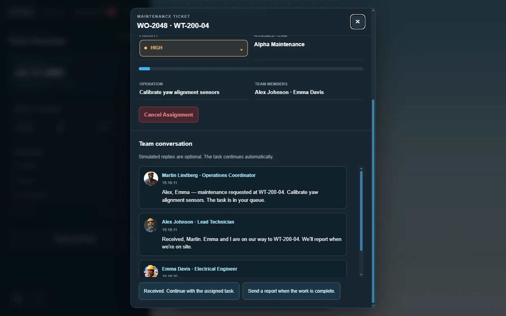
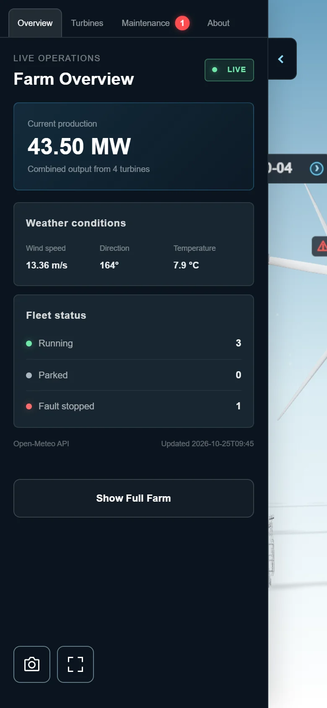

# WindTwin — Operational Wind Farm Digital Twin

[**Explore the live experience →**](https://windtwin.nourtin.com/) · [Portfolio case study](https://nourtin.com/pages/Subpages/windtwin-case-study.html) · [Nour Altinawi / Nourtin](https://nourtin.com/)

A browser-based industrial 3D experience connecting **asset monitoring, environmental context, simulated maintenance, and an animated service workflow** in one wind-farm environment.

**Role:** Real-time 3D development, frontend application development, interaction and interface design, operational simulation, performance optimization, and validation.

**Platform:** Desktop and mobile web.

**Built with:** Three.js / WebGL, TypeScript, Vite, Chart.js, HTML, CSS, and Open-Meteo.

## The project

WindTwin explores how an industrial digital twin can become an understandable operational interface rather than a passive 3D scene. Visitors can select an asset, inspect its condition, follow an alert into a work order, and observe a maintenance vehicle carrying out the simulated service process.

Four primary turbines form the interactive operational core. The expanded view now presents **750 turbines on desktop**, with a **100-turbine mobile configuration**. The additional turbines provide spatial context and visual scale; operational monitoring and maintenance remain focused on the four primary assets.

## Experience at a glance

| Area | What the visitor can do |
| --- | --- |
| Farm overview | Read combined simulated production, fleet status and current weather context. |
| Asset inspection | Select a primary turbine in the scene or asset list and inspect its condition. |
| Monitoring | Follow simulated power, rotor speed, temperature and vibration through rolling charts. |
| Maintenance | Review alerts and tickets, manage queue priority, and follow service progress, team conversations and completed reports. |
| Team communication | Follow simulated radio updates, open the related task, and use optional supervisor replies. |
| Service vehicle | Observe travel, servicing and return activity and inspect the current mission. |
| Operations Center | Explore demonstration personnel, supplies, fleet information and employee profiles. |
| Camera views | Open illustrated turbine camera panels for additional visual context. |
| Expanded farm | Reveal a 750-turbine desktop environment or the lighter 100-turbine mobile view. |
| Presentation | Save a branded scene image and enter fullscreen where supported. |

## 1. Understand the farm at a glance

The overview brings weather, production and fleet status into a compact dashboard beside the 3D scene. Live weather provides environmental context while operational values remain a simulated demonstration. The interface links the farm's overall picture to individual assets, helping visitors move from an overview to a specific turbine without leaving the experience.

## 2. Inspect an asset and its condition

Selecting a primary turbine connects its 3D identity to condition information, operating values and monitoring charts. Visitors can compare power and rotor speed with temperature and vibration, then expand a chart for a closer view. Visual condition feedback also connects the asset in the scene to its simulated health and fault state.

*Turbine values and chart samples are simulated and labelled accordingly; WindTwin is not connected to physical turbine sensors.*

## 3. Follow maintenance as a connected workflow

Simulated faults connect asset condition to alerts, work orders and service activity. The maintenance queue exposes priority and sequencing, while ticket details provide access to the current job and its progress.

A service vehicle travels to the assigned turbine and performs the simulated repair. Completed work appears in maintenance history, linking the original issue to the resulting report and recovered asset state.

Simulated team radio adds context as the job moves from dispatch through travel, arrival, servicing and completion. A radio message opens the corresponding ticket, where visitors can read the task conversation and final maintenance report. Optional preset supervisor replies receive a response appropriate to the task stage without changing the service workflow.

This makes the relationship between **condition, decision, dispatch and outcome** visible within the same experience. Conversations are scripted simulation, not messages from real staff or an AI chat service. Work orders, conversations and reports belong to the browser session; they are not records from a production maintenance backend.

## 4. Explore the wider environment

Full Farm expands the desktop scene to **750 turbines** while retaining the four primary operational assets. Wider spacing and moving shadows give the larger environment a clearer sense of scale. Mobile uses a lighter **100-turbine** configuration.

The updated presentation balances the focused operational view with a much larger surrounding farm. The desktop setting is based on interactive acceptance on the reference PC, rather than a claim that every device will deliver the same frame rate.

## 5. Keep operations and context together

Operations Center and service-vehicle views bring personnel, supplies, mission information and demonstration fleet records into the interface. Employee profiles and illustrated camera views add context without requiring a separate application.

Personnel, inventory, camera images and several detail indicators are demonstration content. Employee buttons illustrate interface behavior rather than performing workforce or inventory transactions.

## 6. Use the experience across devices

The responsive interface supports desktop and mobile layouts with touch navigation. Asset selection on mobile moves visitors from the list into monitoring, keeping the focused task visible.

Branded image capture is available in Overview. Mobile provides a floating fullscreen control that stays accessible outside the drawer and attempts landscape orientation where supported. Viewing/privacy guidance that remains until acknowledged and a dismissible drag hint help visitors enter the experience. The compact mobile panels keep asset information and task conversations readable in a smaller viewport.

Export captures the 3D scene with Nourtin branding, rather than the HTML dashboard. Fullscreen and orientation behavior depend on the browser and device.

  

*These captures come from the published application on 25 October 2026. The portrait image uses browser viewport emulation; it is not physical-phone performance validation.*

## Performance and experience quality

The latest release improves access to the focused scene and prepares the wider experience without making every optional feature part of the initial loading screen. Large-farm rendering and shadow movement have been refined, including a softer shadow presentation for the primary assets.

The maintained graphics baseline is **Three.js 0.186.1**. Library modernization is accompanied by improvements to loading, rendering, responsive interaction and recovery behavior.

The published desktop experience now includes the accepted **750-turbine** configuration. This is a verified feature of the live application, not a universal 60 FPS or sub-second startup promise. Loading time and smoothness vary with hardware, browser, connection and cache state. Mobile retains 100 turbines; desktop browser emulation does not certify physical-phone performance.

Release checks covered startup, exact desktop/mobile farm counts, turbine selection, chart expansion, farm show/hide, image export, fullscreen, tab visibility recovery and loading-failure retry. A graphics-unavailable browser receives an explanation and retry action. These checks support the demonstrated interactions; they do not claim exhaustive validation of every device or maintenance scenario.

## My contribution

- Developed the wind-farm environment and connected its primary assets to the operational interface.
- Designed the monitoring dashboard, responsive panels and asset-selection experience.
- Built the demonstration fault, work-order, vehicle and maintenance-report workflows.
- Integrated live weather context and distinguished it from simulated operational data.
- Expanded the desktop environment to 750 turbines while retaining a lighter mobile configuration.
- Refined loading, rendering and moving-shadow presentation for the larger scene.
- Added task-linked radio conversations, optional supervisor replies and visual asset-condition feedback.
- Added branded scene capture, mobile fullscreen/orientation handling and clearer onboarding guidance.
- Refined compact mobile monitoring, vehicle and maintenance views.
- Modernized the graphics/application libraries and expanded engineering documentation and verification.

The project demonstrates **real-time 3D presentation, frontend engineering and connected industrial interaction** in a browser experience.

## Try the experience

1. Open the overview and compare weather context with fleet status.
2. Select a primary turbine and inspect its monitoring charts.
3. Open Maintenance and follow a simulated alert, work order, team conversation and service mission.
4. Enable Full Farm to explore the wider environment.

[**Open WindTwin →**](https://windtwin.nourtin.com/)

---

**About this repository:** A public portfolio presentation containing descriptions and application screenshots. Application source, optimization algorithms, private operational documentation, database configuration and credentials are excluded. Screenshots were refreshed from the published 750-desktop / 100-mobile release on 25 October 2026 and resized/compressed for presentation. The update is published in the live demo; fullscreen remains dependent on browser support.

Independent prototype by [Nour Altinawi — Nourtin](https://nourtin.com/). WindTwin is not connected to a physical wind farm and is not intended for operational decisions.

